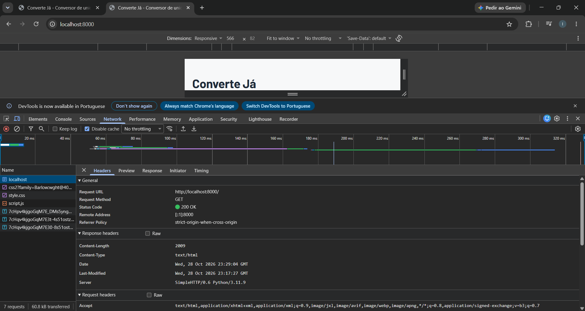

# ConverteJá

Conversor de unidades simples para usuários que precisam
trocar rapidamente entre unidades de comprimento, massa e temperatura durante atividades do dia a dia.
Atividade da disciplina Desenvolvimento de Sistemas Web (EECP0036), UFMA, 2026.2.

## O que o app faz

- Converte valores de **comprimento** (m, km, cm, mi, pés), **massa** (kg, g, lb)
  e **temperatura** (°C, °F, K)
- Aceita número com vírgula ou ponto decimal
- Mostra o resultado com 2 casas decimais
- Guarda as 5 últimas conversões no navegador (localStorage)
- Permite limpar o histórico

**Não faz:** conversão de moedas, login ou sincronização entre aparelhos, conversão
entre categorias diferentes (ex.: km para kg).

## Exemplo de uso

1. Escolha a categoria **Comprimento**
2. Digite `5` no campo "Valor"
3. Selecione **quilômetros** como origem e **milhas** como destino
4. Clique em **Converter**
5. Resultado: `5 km = 3,11 mi`

## Tecnologias

Trilha C (sem API): HTML, CSS e JavaScript puros, sem frameworks. Os dados do
histórico ficam no localStorage do navegador.

## Como rodar

1. Clone o repositório:
   git clone https://github.com/ItaloMatheus10/converteja.git
2. Abra a pasta e rode um servidor local, por uma destas opções:
   - VS Code com a extensão **Live Server** (botão "Go Live")
   - Terminal: `python -m http.server 8000` e acesse http://localhost:8000

## Aba Rede

O print mostra a requisição que carregou a página do app, feita pelo navegador ao
servidor local do Python (`python -m http.server 8000`): método **GET**, URL
`http://localhost:8000/` e status **200 OK**, indicando que o `index.html` foi
entregue com sucesso. As demais requisições da lista são o `style.css`, o
`script.js` e a fonte Barlow; como o app é da trilha C, não há chamadas a APIs,
e os dados ficam no localStorage do navegador.

## Autor
Nome: Italo Matheus 